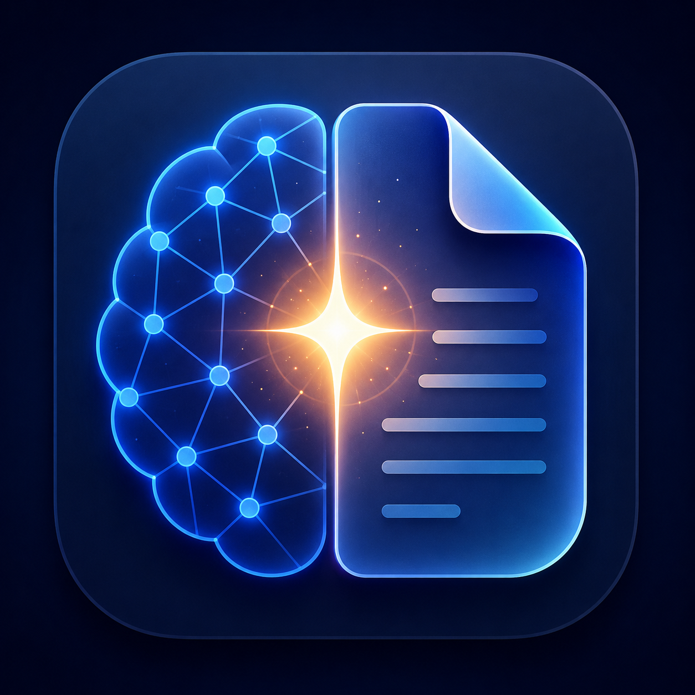

#  Umay

<div align="center">
  <strong>AI-Assisted Note Manager</strong> | <strong>Yapay Zeka Destekli Not Yöneticisi</strong>
  <br><br>
  
  
  
  
  <br><br>
  
  <br><br>
  
</div>

---

<details open>
<summary><h2>🇬🇧 English</h2></summary>

## 🚀 What is Umay?

**Umay** is a **local-first** note-taking application for developers and thinkers. Everything runs on your machine — there is no account, no cloud backend, and no telemetry. Your data is written to a single JSON file (`~/Documents/AI-Notes/notes.json`) and stays there.

Umay is "AI-assisted" in two concrete, on-device ways:

1. **AI prompt export** — turn a whole project (or a single note) into a structured prompt you can paste into ChatGPT, Claude, or any LLM. Umay never calls an LLM itself; you stay in control of where your data goes.
2. **On-device text analysis** — note summaries, tag suggestions and related-note discovery run as local heuristics (keyword/tag overlap, sentence extraction). No network request is ever made.

### ✨ Key Features

#### 📝 Note Management
- **Multiple note types**: Notes, Tasks, and Ideas
- **Projects**: Organize notes into project-based collections
- **Tags**: Tagging system with a tag-cloud visualization
- **Pin & Star**: Mark important notes for quick access
- **Kanban board**: Drag-and-drop task management
- **Search**: ⌘K fast search across all notes

#### 🤖 AI-Assisted (local & explicit)
- **AI Export**: Generate structured prompts from a project or note for ChatGPT, Claude, or any LLM
- **Smart Tags**: On-device tag suggestions from note content
- **Related Notes**: Content-similarity note discovery (word/tag overlap)
- **Note Summaries**: Extractive summary generated from the note text

#### ⚡ Productivity
- **Focus Mode**: Distraction-free writing
- **Split View**: Side-by-side note editing
- **Daily Notes**: Daily journaling with automatic date tracking
- **Word Count & Reading Time**: Live statistics per note
- **Quick Note**: Capture a thought with ⌘⇧N

#### 🔄 Advanced
- **Note History**: Version tracking with restore
- **Backlinks**: `[[wiki-link]]` cross-referencing between notes
- **Attachments**: File attachments per note
- **Reminders**: Due-date reminders for tasks
- **Archive / Trash**: Soft-delete with recovery
- **Smart Folders**: Dynamic filtered views (recent, starred, long, untagged…)
- **Batch Operations**: Multi-select and bulk actions
- **Statistics Dashboard**: Visual analytics of your notes
- **Export**: Markdown, JSON, and AI-prompt export
- **Dark Mode**: Full dark theme

### ⌨️ Keyboard Shortcuts

| Shortcut | Action | Shortcut | Action |
|---|---|---|---|
| `⌘K` | Search | `⌘⇧I` | AI Features |
| `⌘N` | New Note | `⌘⇧E` | AI Export |
| `⌘S` | Save | `⌘⇧V` | Split View |
| `⌘T` | Templates | `⌘⇧K` | Kanban / Grid |
| `⌘⇧P` | New Project | `⌘⇧F` | Focus Mode |
| `⌘⇧N` | Quick Note | `⌘⇧B` | Backlinks |
| `⌘⇧D` | Daily Notes | `⌘⇧H` | History |
| `⌘⇧G` | Tags Cloud | `⌘⇧S` | Statistics |
| `⌘⇧M` | Smart Folders | `⌘⇧O` | Export |
| `⌘⇧L` | Starred | `⌘⇧A` | Archive |
| `⌘⇧R` | Reminders | `⌘⇧X` | Trash |
| `⌘⇧T` | Table of Contents | `⌘⇧U` | Batch Operations |
| `Esc` | Close modal | | |

### 🖼️ Screenshots

<div align="center">
  
  <br><sub><i>Main Project View with Grid Layout</i></sub>
  <br><br>
  
  <br><sub><i>Project Detail View with Note Editor</i></sub>
  <br><br>
  
  <br><sub><i>AI Export - Generate structured prompts for LLMs</i></sub>
  <br><br>
  
  <br><sub><i>Kanban Board - Drag & Drop Task Management</i></sub>
  <br><br>
  
  <br><sub><i>Dark Mode - Easy on the eyes</i></sub>
</div>

### 🛠️ Installation & Development

```bash
# Clone the repository
git clone https://github.com/nickzsche/Umay.git
cd Umay

# Install dependencies
npm install

# Run the renderer in dev mode
npm run dev

# Type-check and build the renderer + Electron main/preload
npm run build

# Build installers (dmg / nsis / AppImage) into ./release
npm run package
```

`npm run build` runs `tsc` (strict type-check) followed by `vite build`, producing `dist/` (renderer) and `dist-electron/` (main + preload).

### 🎯 Use Cases

- **Project Documentation**: Document APIs, architecture decisions, and bug reports
- **Knowledge Management**: Build a personal knowledge base with interconnected notes
- **Task Management**: Track todos and milestones with a Kanban board
- **AI Context Preparation**: Export project context as structured prompts for AI assistants
- **Daily Journaling**: Daily notes with automatic date tracking

### 🛡️ Privacy & Security

- **100% Local**: All data stored in `~/Documents/AI-Notes/notes.json`
- **No Cloud, No Telemetry**: No internet connection required, no external servers
- **Hardened Electron renderer**: `contextIsolation: true`, `nodeIntegration: false`, `sandbox: true`; external links are handed to the OS browser, and window creation / navigation is denied by default

### 🏗️ Tech Stack

- **Electron 33**: Cross-platform desktop framework
- **React 18**: UI library with hooks
- **TypeScript 5.6**: Strict, type-safe development
- **Tailwind CSS 3.4**: Utility-first styling
- **Vite 6**: Fast build tool
- **Lucide React**: Icons

</details>

---

<details>
<summary><h2>🇹🇷 Türkçe</h2></summary>

## 🚀 Umay Nedir?

**Umay**, geliştiriciler ve düşünenler için tasarlanmış **tamamen yerel (local-first)** bir not tutma uygulamasıdır. Her şey cihazınızda çalışır — hesap yok, bulut arka uç yok, telemetri yok. Verileriniz tek bir JSON dosyasına (`~/Documents/AI-Notes/notes.json`) yazılır ve orada kalır.

Umay iki somut, cihaz-içi yolla "yapay zeka desteklidir":

1. **AI prompt export** — Bir projeyi (veya tek bir notu) ChatGPT, Claude ya da herhangi bir LLM'e yapıştırabileceğiniz yapılandırılmış bir prompt'a dönüştürür. Umay kendisi hiçbir LLM'e istek atmaz; verinizin nereye gideceğini siz kontrol edersiniz.
2. **Cihaz-içi metin analizi** — Not özetleri, etiket önerileri ve ilişkili not bulma tamamen yerel sezgisel yöntemlerle (kelime/etiket örtüşmesi, cümle çıkarımı) çalışır. Hiçbir ağ isteği yapılmaz.

### ✨ Temel Özellikler

#### 📝 Not Yönetimi
- **Çoklu not türleri**: Notlar, Görevler ve Fikirler
- **Projeler**: Notları proje bazlı koleksiyonlarda organize edin
- **Etiketler**: Etiket bulutu görselleştirmeli etiketleme
- **Pin & Star**: Önemli notları hızlı erişim için işaretleyin
- **Kanban panosu**: Sürükle-bırak görev yönetimi
- **Arama**: Tüm notlarda ⌘K hızlı arama

#### 🤖 Yapay Zeka Desteği (yerel ve şeffaf)
- **AI Export**: Proje veya nottan ChatGPT, Claude ya da herhangi bir LLM için yapılandırılmış prompt üretin
- **Akıllı Etiketler**: Not içeriğinden cihaz-içi etiket önerileri
- **İlişkili Notlar**: İçerik benzerliğine dayalı not keşfi (kelime/etiket örtüşmesi)
- **Not Özetleri**: Not metninden çıkarımsal özet

#### ⚡ Verimlilik
- **Odak Modu**: Dikkat dağıtıcı unsurlardan arındırılmış yazma
- **Bölünmüş Görünüm**: Yan yana not düzenleme
- **Günlük Notlar**: Otomatik tarih takibi ile günlük tutma
- **Kelime Sayısı & Okuma Süresi**: Her not için canlı istatistik
- **Hızlı Not**: ⌘⇧N ile anında fikir kaydı

#### 🔄 Gelişmiş
- **Not Geçmişi**: Kurtarmalı sürüm takibi
- **Geri Bağlantılar**: Notlar arası `[[wiki-link]]` çapraz referans
- **Ekler**: Not başına dosya eki
- **Hatırlatıcılar**: Görevler için son tarih hatırlatıcıları
- **Arşiv / Çöp Kutusu**: Kurtarmalı yumuşak silme
- **Akıllı Klasörler**: Dinamik filtreli görünümler (son eklenen, yıldızlı, uzun, etiketsiz…)
- **Toplu İşlemler**: Çoklu seçim ve toplu eylemler
- **İstatistik Dashboard**: Notların görsel analitiği
- **Dışa Aktarma**: Markdown, JSON ve AI prompt export
- **Karanlık Mod**: Tam karanlık tema

### ⌨️ Klavye Kısayolları

Yukarıdaki İngilizce bölümdeki kısayol tablosu ile aynıdır (`⌘`, macOS'ta Command; Windows/Linux'ta Ctrl).

### 🖼️ Ekran Görüntüleri

<div align="center">
  
  <br><sub><i>Ana Proje Görünümü - Grid Düzeni</i></sub>
  <br><br>
  
  <br><sub><i>Proje Detay Görünümü - Not Editörü</i></sub>
  <br><br>
  
  <br><sub><i>AI Export - LLM'ler için yapılandırılmış prompt'lar oluşturun</i></sub>
  <br><br>
  
  <br><sub><i>Kanban Panosu - Sürükle Bırak Görev Yönetimi</i></sub>
  <br><br>
  
  <br><sub><i>Karanlık Mod - Göz Yorulmasını Önler</i></sub>
</div>

### 🛠️ Kurulum ve Geliştirme

```bash
# Repoyu klonlayın
git clone https://github.com/nickzsche/Umay.git
cd Umay

# Bağımlılıkları yükleyin
npm install

# Renderer'ı geliştirme modunda çalıştırın
npm run dev

# Tip kontrolü + renderer ve Electron main/preload derlemesi
npm run build

# Kurulum paketlerini (dmg / nsis / AppImage) ./release içine üretin
npm run package
```

`npm run build`, `tsc` (katı tip kontrolü) ardından `vite build` çalıştırır; `dist/` (renderer) ve `dist-electron/` (main + preload) üretir.

### 🎯 Kullanım Alanları

- **Proje Dokümantasyonu**: API'leri, mimari kararları ve hata raporlarını dokümante edin
- **Bilgi Yönetimi**: Birbirine bağlı notlarla kişisel bilgi tabanı oluşturun
- **Görev Yönetimi**: Kanban panosuyla todo ve kilometre taşlarını takip edin
- **AI Bağlam Hazırlama**: Proje bağlamını AI asistanlarına yapılandırılmış prompt olarak export edin
- **Günlük Tutma**: Otomatik tarih takibi ile günlük notlar

### 🛡️ Gizlilik ve Güvenlik

- **%100 Yerel**: Tüm veriler `~/Documents/AI-Notes/notes.json` içinde saklanır
- **Bulut ve Telemetri Yok**: İnternet bağlantısı gerekmez, harici sunucu yok
- **Sıkılaştırılmış Electron renderer**: `contextIsolation: true`, `nodeIntegration: false`, `sandbox: true`; harici bağlantılar işletim sistemi tarayıcısına devredilir, yeni pencere ve yönlendirmeler varsayılan olarak engellenir

### 🏗️ Teknoloji Yığını

- **Electron 33**: Çapraz platform masaüstü framework'ü
- **React 18**: Hook'larla UI kütüphanesi
- **TypeScript 5.6**: Katı, tip güvenli geliştirme
- **Tailwind CSS 3.4**: Utility-first stil
- **Vite 6**: Hızlı build aracı
- **Lucide React**: İkonlar

</details>

---

<div align="center">
  <br>
  <strong>Made with ❤️ for developers and thinkers</strong>
  <br>
  <sub>Geliştiriciler ve düşünenler için ❤️ ile yapıldı</sub>
  <br><br>
  <a href="https://github.com/nickzsche/Umay/stargazers">⭐ Star</a> • 
  <a href="https://github.com/nickzsche/Umay/issues">🐛 Report Bug</a> • 
  <a href="https://github.com/nickzsche/Umay/issues">💡 Feature Request</a>
</div>
